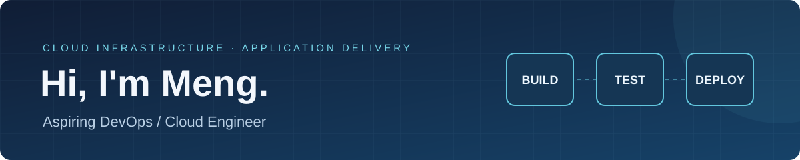

Aspiring DevOps / Cloud Engineer · Cloud infrastructure & application delivery

## About me

I build hands-on cloud and DevOps projects, focusing on reproducible infrastructure, tested application builds, and clear operational documentation.

## Featured projects

### [AWS Terraform Network Lab](https://github.com/meng81593-byte/aws-terraform-network-lab)

An AWS VPC network foundation with public and private subnets across two Availability Zones in the Paris region.

**Focus:** infrastructure as code, network boundaries, routing, and repeatable verification.

### [Little Steps DevOps](https://github.com/meng81593-byte/little-steps-devops)

A team-created Phaser browser game that I continued updating, packaged with Docker and checked by GitHub Actions. My original contributions covered the game concept, page/interface design, routes, visuals, and backgrounds.

**Focus:** reproducible builds, containers, CI, and application delivery.

## Current work

- Strengthening automated checks and regression tests.
- Connecting Terraform networking to a verifiable deployment workflow.
- Documenting health checks, recovery, and experiment cleanup.

Explore the pinned repositories for source code, architecture, setup instructions, and project evidence.
